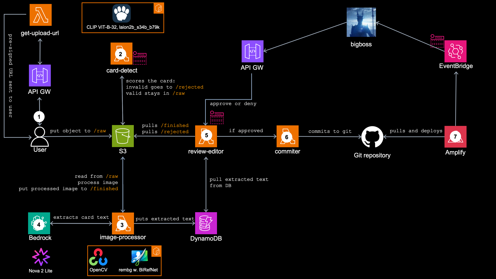

<!--
SPDX-License-Identifier: MIT
Copyright (c) 2026 Michal Salanci
-->

# Image processing pipeline, created for AWS Builder Cards Database Infrastructure

A community catalog of collectible [AWS Builder Cards Database](LINK). 
Anyone can upload a card photo — no sign-in; a cheap ML gate rejects junk and the image is auto-cleaned and described by a vision model. [Michal](https://www.michalsalanci.com) approves it, it's automatically committed to GitHub and published as a static **Hugo** site hosted on **AWS Amplify**.

This repository is the **serverless backend only**: terraform under
`infrastructure/` building lambda + S3 + DynamoDB + SNS + EventBridge, with no
always-on compute and near-zero cost while idle. 
The Hugo site lives in a **separate repository** (the one the committer publishes into); no site source is here.

This pipeline can be used to **process any images**, not just AWS Builder Cards. See [How can you use it?](#how-can-you-use-it) for more.

---

## Architecture



### The flow

1. User hit `Upload your card` on a website, lamnda `get-upload-url` returns a **presigned S3 POST**, which user use to directly upload the image into s3 bucket's prefix `images/raw`.
2. Lambda `card-detect` running `CLIP ViT-B-32, laion2b_s34b_b79k` vision model on `onnxruntime`, plus `Pillow`, perform filter. Valid AWS cards stays in `images/raws`, everything else is moved to `images/rejected`.
3. Lambda `image-processor`, running a model `BiRefNet-General-Lite` via `rembg` on `onnxruntime` along with math tools `OpenCV` and `NumPy` remove the background, straightens the card and crops it. Processed image is sent to `images/finished/`
4. Same lambda parallelly sends a card image to `Bedrock`, where model `Nova Lite 2` is used to extract the text from it, which is then stored in `DynamoDB` as a card's metadata.
5. Lambda `review-editor` reads s3 bucket - both `/finished` and `/rejected` prefix, as well as metadate in `DynamoDB`. It creates a html page accessible for the admin through sepparate `API Gateway` where admin have to approve or reject freshly proceesed card.
6. If approved, lambda `committer` creates the **markdown** file of particular card and commits and push it along with the card's processed picture to the GitHub repo.
7. `Amplify` running static site generator `Hugo` pulls it grom the GitHub repo, generates the html from the mardown files uplaoded by `commiter` and publish the page to public web.

<!--
```text
upload form (static site, separate repo)
   │  POST /get-upload-url         API Gateway — public, no auth
   ▼
get-upload-url (zip)               returns a 5-min presigned S3 POST, size-capped
   │  browser multipart POST
   ▼
s3://<bucket>/images/raw/<event>_<year>_<uuid>.jpg   ← key always ends .jpg (see Uploads)
   │  S3 ObjectCreated (.jpg suffix)
   ▼
card-detect (container)            ONNX CLIP gate → P(AWS card)
   │  card / unsure → async-invoke image-processor
   │  junk → quarantine to images/rejected/ + reject email   …(stop)
   ▼
image-processor (container, arm64, 10 GB)
   │  rembg/BiRefNet background removal + OpenCV straighten
   │  Bedrock (Nova vision) drafts title/effect/description
   │  DynamoDB item (status=pending) + finished PNG + "go review" email
   ▼
review-editor (zip, HTTP Basic Auth)   list / edit / approve / delete
   │  on approve or delete → invoke committer
   ▼
committer (zip, holds the GitHub PAT)
   │  one atomic commit: <slug>.md + <cardId>.png → publish branch
   ▼
GitHub → Amplify rebuilds the Hugo site → deploy-status email
-->```

Five Lambdas, least privilege:

| Lambda            | Exposure                       | Holds a secret? |
| ----------------- | ------------------------------ | --------------- |
| `get-upload-url`  | **Public** (unauthenticated)   | no              |
| `review-editor`   | **Internet** (HTTP Basic Auth) | basic-auth      |
| `card-detect`     | Internal (S3 event)            | no              |
| `image-processor` | Internal (gate invoke)         | no              |
| `committer`       | Internal (invoke-only)         | GitHub PAT      |

**Security model:** ``DynamoDB` is the source of truth — the `committer` re-reads the
card and re-verifies `status=approved` itself, never trusting its caller. The
GitHub PAT (the only credential that can change the public site) lives solely in
the internal, invoke-only committer, never in the internet-facing review editor.
Human approval is the gate; the AI only drafts.

The real depth is in the per-Lambda READMEs:
[card-detect](infrastructure/lambda/card-detect/README.md) (how the CLIP gate
scores) · [image-processor](infrastructure/lambda/image-processor/README.md)
(segmentation, memory ceilings, running it locally).

---

## Repository layout

```
AGENTS.md                  conventions for humans + AI coding agents
infrastructure/            all Terraform (*.tf); Lambda source under lambda/<fn>/
  terraform.tfvars         deployer config — placeholders only, no secrets
  lambda/card-detect/      the gate + build_onnx.py model export (own README)
  lambda/image-processor/  the cleanup pipeline (own README)
```

---

## Prerequisites

Create these **before** the first `terraform apply` (none are managed here):

- A **GitHub repo** holding your Hugo site, with a publish branch that **allows
  direct pushes** (`github_owner` / `github_repo`). Don't require PRs on it —
  the committer pushes straight to it; human review is the gate instead.
- An **AWS Amplify app** connected to that repo, created in the console and
  referenced here only by ID. Its App ID is the `amplify_app_id` variable, which
  has **no default — `terraform apply` fails without it**.
- **Bedrock model access** for the inference profile you set as `bedrock_llm`
  (default `eu.amazon.nova-2-lite-v1:0`). It must match your region family:
  `eu.*` in an EU region, `us.*` in a US one, etc.

On the machine running apply: **Terraform ≥ 1.15**, **Docker with buildx** (both
container images build for arm64 and push to ECR *during* apply), **AWS
credentials**, and **Python 3** (for Setup step 2).

---

## Setup

### 1. Configure `infrastructure/terraform.tfvars`

Edit the `<your-...>` placeholders in place: bucket name, email, GitHub
owner/repo/branches, region, `bedrock_llm`, `amplify_app_id`. The three `*_dir`
values at the bottom are optional — they only shape the copy-paste commands in
the notification email, so point them at your own machine's layout. The file is
tracked, so don't commit your real values back — and **never put secrets in it**
(those are set in step 4).

### 2. Generate the card-detect model — required before the first apply

The gate bakes a CLIP ViT-B/32 image encoder, exported to ONNX, into its
container. The artifacts are **git-ignored** (`visual.onnx.data` is ~335 MB) and
fully regenerable; `ecr.tf` hashes them at apply time, so generate them once:

```bash
cd infrastructure/lambda/card-detect
python3 -m venv .venv && source .venv/bin/activate
pip install -U pip
pip install -r build_onnx-requirements.txt  # NOT requirements.txt — that's the torch-free runtime list
python build_onnx.py                        # writes onnx_out/{visual.onnx, visual.onnx.data, text.npz}
```

Keep `onnx_out/` on disk; every container build bakes it in. PyTorch is used
only here — the deployed gate runs torch-free (onnxruntime + numpy + pillow).

> **`ModuleNotFoundError: No module named 'onnxscript'` at export:** since torch
> 2.9, `torch.onnx.export()` defaults to the dynamo exporter, which needs
> `onnxscript` — and torch imports it *lazily*, so `pip install` succeeds and the
> failure only appears at export time. It's pinned in
> `build_onnx-requirements.txt`; on an older checkout, re-run the install above.

(The image-processor's BiRefNet-General-Lite weights, ~224 MB, download during
its Docker build — no manual step.)

### 3. Deploy

```bash
cd infrastructure
terraform init
terraform apply   # macOS + Docker Desktop: read Deploy gotchas below first
```

Apply builds + pushes both container images and creates everything, including
two **empty** Secrets Manager containers. Terraform never sees the values.

### 4. Populate the two secrets — after apply, out-of-band

`put-secret-value` needs the container to exist, which is why this follows
apply. Until each value is set, its dependent Lambda fails closed.

```bash
# Review-editor Basic Auth — JSON {username, password}
U=$(openssl rand -hex 16); P=$(openssl rand -base64 32)
aws secretsmanager put-secret-value --secret-id buildercards/review-basic-auth \
  --secret-string "{\"username\":\"$U\",\"password\":\"$P\"}" --region <your-region>
echo "user: $U  pass: $P"   # save in your password manager

# Committer GitHub PAT — fine-grained, scoped to ONLY your site repo,
# permissions: Contents read/write + Metadata read-only. Set an expiry.
aws secretsmanager put-secret-value --secret-id buildercards/github-pat \
  --secret-string 'github_pat_xxxxx' --region <your-region>
```

### 5. Verify

`terraform output review_editor_url`, open it, log in with the step-4
credentials, approve a pending card: the committer pushes to your publish
branch, Amplify rebuilds the site, and the deploy-status email arrives.

---

## Uploads

- **Formats:** JPG, PNG, HEIC, WebP, BMP, TIFF (HEIC via `pillow-heif` — iPhone
  photos work). The content type is validated against that allow-list, but the
  object key **always ends in `.jpg`** whatever the real format: the S3 trigger
  filters on that suffix, and every decoder downstream reads bytes, not names.
- **Max size:** 25 MiB (`max_upload_bytes`), enforced by S3 through the
  presigned **POST**'s `content-length-range` condition — a POST, not a PUT,
  because the POST policy is what carries that condition.
- **Attribution:** the form takes an optional uploader name (60 chars), stored
  as S3 object metadata and carried into the card's DynamoDB record. It is
  self-declared and unverified — treat it as a label, not an identity.

---

## How can you use it?

Nothing in this pipeline is specific to AWS Builder Cards except the **words**.
It works for any flat collectible — trading cards, postcards, stamps, badges —
and pointing it at yours is mostly editing English sentences. There is no model
to train and no dataset to collect.

| To change                       | Edit                                                                                                                                      | Needs a rebuild?                          |
| ------------------------------- | ----------------------------------------------------------------------------------------------------------------------------------------- | ----------------------------------------- |
| **What counts as *your* card**  | the three label groups in `lambda/card-detect/build_onnx.py` — describe your cards in `AWS_LABELS`, keep the rest as distractors to score against | yes — re-run `build_onnx.py`, then apply |
| **How strict the gate is**      | `KEEP_THRESHOLD` / `DROP_THRESHOLD` in `lambda.tf`                                                                                          | no, env vars only                         |
| **What text is extracted**      | `EXTRACT_SYSTEM` / `EXTRACT_PROMPT` in `lambda/image-processor/app.py`                                                                      | yes, container rebuild                    |
| **Which fields a card has**     | `write_card_item` in `app.py`, plus the form in `lambda/review-editor/index.py`                                                             | no, zip Lambdas ship on apply             |
| **Background behind the card**  | `BACKGROUND` env var — `black`, `white` or `none` (transparent)                                                                             | no                                        |
| **How the published page looks**| your own Hugo templates, in your site repo                                                                                                  | no                                        |

Adding a category is the cheap part: write one more sentence describing it, and
the gate scores against it from the next build. That is what zero-shot buys you.

**The one real constraint:** corner detection assumes a **rectangular card with
rounded corners** — it fits a straight line to each edge and intersects them.
Round, die-cut or irregular shapes need a different `find_quad`.

### The story behind it

Five articles on why it is built this way. The trade-offs, the measurements andthe things that broke:

1. [From anonymous photo to published page: An event-driven AI pipeline on AWS](link) - TBD
2. [Is this even a valid card? Zero-shot image classification model in a lambda container](link) - TBD
3. [Where exactly is card in this photo? Image segmentation model inside a maxed-out lambda container](link) - TBD
4. [What does the card say? Text extraction using Amazon Nova Lite 2](link) - TBD
5. [Who reviews the reviewer? Building the human step in an AI pipeline](link) - TBD

---

## Deploy gotchas (container builds)

`terraform apply` shells out to `docker buildx` on your machine. On macOS +
Docker Desktop, three failures are routine:

- **`public.ecr.aws/...: 403 Forbidden`** on the base-image pull — a stale
  public-ECR token in the keychain. `docker logout public.ecr.aws`, re-apply.
- **`error storing credentials ... (-25299)`** — keychain write-race: Terraform
  builds both containers in parallel and both `docker login` at once. Run
  `terraform apply -parallelism=1`.
- **`Cannot connect to the Docker daemon`** — Docker Desktop isn't running;
  wait for `docker info` to succeed, then apply.

A failed build deploys nothing — Terraform aborts before touching the Lambda,
so the running stack stays on its previous images.

---

## License

MIT — see [LICENSE](LICENSE), and the SPDX headers on each file. AWS Builder
Cards artwork is AWS community material.
